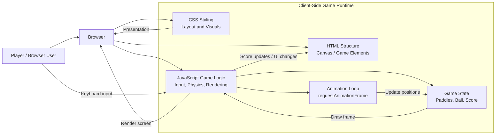

# Architecture Overview

This project is a classic browser-based Pong game built with HTML, CSS, and JavaScript. The architecture is intentionally lightweight and runs entirely in the client.

## Components

- HTML: Provides the structure for the game screen and UI elements.
- CSS: Styles the game area, paddles, ball, scoreboard, and overall layout.
- JavaScript: Manages the game loop, keyboard controls, collision detection, scoring, and animation.
- Browser runtime: Executes the client-side code and renders the game in the DOM and canvas-like output.

## Runtime Flow

1. The browser loads the page and initializes the game.
2. JavaScript sets up the initial state for the paddles, ball, and score.
3. Keyboard input is captured to move the player paddle.
4. The animation loop updates game physics each frame.
5. The rendered frame is displayed to the player, and scoring is updated as needed.
